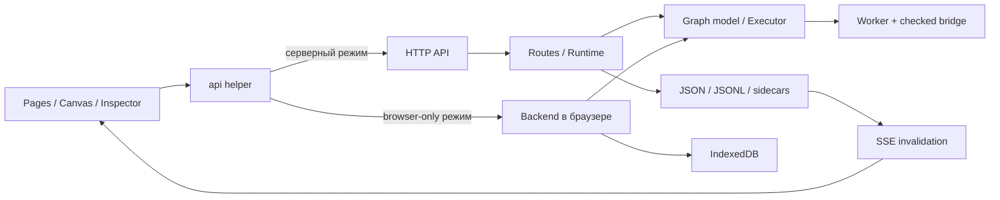

# Полный аудит AgentSys — 29 октября 2026

> Subsequent UI changes and verification: [interface follow-up](interface-polish.md). Findings below describe the audit baseline.

## Главный вывод

AgentSys уже имеет содержательный движок: живые изменения графа, durable waits, состояние, очереди, повторные попытки, ограничения прав, вмешательство человека, версии и replay. Для локальной работы одного технического пользователя это сильная основа. Основные ограничения сейчас находятся в пользовательском сценарии, наблюдаемости и хранении, а не в количестве доступных функций.

Следующий этап стоит посвятить законченному циклу **создать → запустить → понять результат → исправить → восстановить**. Добавление новых возможностей до завершения этого цикла увеличит сложность быстрее, чем полезность продукта.

**Не рекомендую пока удалять Runs.** История активаций и восстановление нужны непрерывным workflows. Рекомендую оставить Runs как монитор выполнения, перенести связанные с конкретным workflow настройки и версии в его контекст, а глобальные ограничения — в Settings. Это предложение; в рамках аудита раздел не удалялся и заново не перестраивался.

## Область и достоверность

Проверены структура репозитория, загрузка приложения, сервер, оба режима хранения, модель графа, исполнение и восстановление, разрешения, плагины, импорт/экспорт, API, навигация, канвас, инспектор, формы, темы, мобильные сценарии, тесты, документация и инструменты сборки. Рассмотрены как исходный код, так и наблюдаемое поведение.

Инвентаризация на начало аудита: 74 JS-файла, около 21,8 тыс. строк JS; 10 CSS-файлов. Наиболее крупные файлы: `model/editor.js` — 1412 строк, `inspector/inspector.js` — 1267, `model/executor.js` — 1206, `backend/routes-runs.js` — 1178. Размер файла сам по себе не дефект; здесь он показывает места, где сходится много обязанностей.

Это широкий инженерный аудит, **не доказательство отсутствия всех ошибок**. Ручной разбор сосредоточен на границах доверия, сохранении данных, выполнении и пользовательских сценариях; не утверждается построчная формальная проверка каждого файла. Не проводились многосуточный soak-тест, испытания реального отключения питания, независимый пентест, тестирование на реальных телефонах, в Firefox/Safari или со скринридером. Пользовательская папка `data/` не использовалась как тестовый стенд и не изменялась. Испытания использовали временные базы и синтетические данные.

Метки ниже: **воспроизведено** — наблюдалось в тесте/браузере; **код** — следует из реализации; **предложение** — проектное решение, требующее оценки с пользователями.

## Что исправлено в ходе аудита

| Приоритет | Ошибка до исправления | Что изменилось | Проверка |
|---|---|---|---|
| P0 при сетевой публикации | `/__data` обходил токен `/api`; при `HOST=0.0.0.0` сырое хранилище оставалось доступным | Токен теперь требуется и для чтения, записи и SSE хранилища. Без токена на non-loopback хранилище закрыто | `server.test.js`: оба префикса URL, чтение ключей, запись, SSE, авторизованный запрос |
| P0 при сетевой публикации | При внешнем `DATA_DIR` старая `ROOT/data` могла раздаваться статикой | Закрыты обе папки данных, включая варианты регистра и имён Windows; статика ограничена публичными каталогами | `server.test.js`: подставной приватный файл без чтения пользовательских данных, `DATA`, `data.`, `data%20`, закрытые серверные файлы |
| P1 | Отказ хранилища мог выглядеть как работа с новой браузерной базой | Ответы 401/403/503 при обнаружении хранилища явно останавливают открытие приложения | `browser_navigation_audit.py`: нет Dashboard, видна ошибка доступа |
| P1 | Webhook с повреждённым JSON, массивом или `null` запускал workflow с `{}` | Неверный payload получает 400 и не создаёт активацию | `server.test.js` |
| P1 | Редактирование `SKILL.md` на диске не инвалидировало кеш работающего сервера | Markdown-файлы включены в наблюдение за файлами | `catalog-storage.test.js`: изменение без перезапуска, повторное чтение через API |
| P2 | В уведомлении допускалась ссылка `//external.example`, хотя контракт разрешает страницы приложения | Ссылки с внешним хостом через `//` отклоняются | `notifications.test.js` |
| P2 | Dashboard запрашивал детали каждого проекта только ради числа workflows | Используется уже имеющийся `workflow_count` | Измерение на 100 проектах: **103 → 3 API-запроса**, около **71 → 33–38 мс** |

Ограничение авторизации: встроенного экрана входа и передачи Bearer-токена браузерным клиентом пока нет. С токеном HTTP API доступен авторизованным клиентам, а UI без внешнего механизма авторизации покажет ошибку. Раньше это не было рабочим защищённым UI: вызовы `/api` из него уже не передавали токен. Полноценную браузерную сессию следует реализовать отдельно; возвращать анонимный доступ к сырому хранилищу нельзя.

Также исправлены устаревшие шаги браузерных тестов: импорт через действующее меню, выбор созданного тестом узла вместо первого встроенного, раскрытие Available nodes перед кликом, пять мобильных разделов, сравнение типов с фактическим набором. Проверки цветов ждут завершения анимации; пиксельные проверки стыков отключают декоративный шум, сохраняя проверку геометрии и непрерывности цвета.

## Приоритетный список оставшихся проблем

P1 — следующий рабочий этап; P2 — после стабилизации основных сценариев; P3 — улучшения удобства. Сроки намеренно не оценены без согласования конечного объёма.

| ID | Приоритет / основание | Проблема и последствия | Предлагаемое решение и критерий готовности |
|---|---|---|---|
| A01 | P1, воспроизведено | Runs не обновляется при внешней активации. После удаления Refresh пользователь видит устаревшую картину | SSE-инвалидация/подписка с объединением частых событий; обновлять строки, не заменять редактируемые формы. Новый run и конечный статус появляются без перехода по страницам; фильтр, фокус и trace сохраняются |
| A02 | P1, код | Runs по умолчанию получает только 50 записей, но фильтр применяется к загруженному списку. Нет перехода к остальной истории | Серверные фильтры workflow/status/time, курсорная пагинация, явное «показано X». Найти старую ошибку за пределами первых 50 |
| A03 | P1, код | Dashboard считает «Active runs» и «Failures, 24 h» по последним 200 записям. Это выборка, а не надёжные общие счётчики | Endpoint агрегатов по состоянию и времени. Проверка на >200 активациях с более старой активной/неуспешной записью |
| A04 | P1, измерено | Сохранение сканирует всё дерево файлов синхронно; задержка растёт с общей базой, даже если изменена одна настройка | Обновлять отметки только затронутых ключей, полную сверку оставить фоновому наблюдению. Повторить storage benchmark; запись настройки должна слабо зависеть от числа чужих файлов |
| A05 | P1, код | История версий растёт без retention/GC; перемещение узла меняет документ и создаёт новую версию | Политика хранения, объединение последовательных layout-изменений; GC с учётом ссылок из runs/replay. Нельзя удалить версию, нужную восстановлению |
| A06 | P1, код | Один каталог данных не защищён от запуска второго процесса-сервера. Внутренняя очередь блокировок действует только в одном процессе | Эксклюзивный lock владельца хранилища с диагностикой и безопасной обработкой устаревшего lock. Второй процесс должен отказать до записи |
| A07 | P1, код | `net` сначала полностью читает `response.text()`, потом проверяет размер; лимит не ограничивает потребление памяти во время загрузки | Ограничивать поток по байтам и отменять чтение при превышении. Проверить бесконечный/большой chunked response, Unicode, отмену и освобождение соединения |
| A08 | P1 для сетевого UI, код | Нет браузерной auth-сессии, разграничения пользователей, TLS-конфигурации и изоляции нескольких владельцев | Сначала явно зафиксировать local single-owner режим. Для сетевого UI — серверная сессия и защита изменяющих запросов; для нескольких пользователей — отдельная модель владения и проверки всех маршрутов |
| A09 | P1, код | В настройках workflow находится политика **всего проекта**. Подсказка есть, но визуальный контекст обещает более узкое действие | Явное название «Project permissions» и имя проекта либо отдельная политика workflow, ограниченная проектной. Изменение одного workflow не должно неожиданно расширять права соседнего |
| A10 | P1, UX | Первый запуск открывает пустые списки; создание спрятано в меню, непонятно, какие узлы нужны и почему Run ничего полезного не делает | Прямые действия «Создать проект», «Открыть пример», один готовый рабочий шаблон, понятный результат на канвасе. Проверка с новым пользователем без чтения документации |
| A11 | P1/P2, код | Повторные попытки и resume выполняют код с начала; внешние эффекты могут повториться | Показывать семантику повторного исполнения возле resume/retry; давать готовые примеры с idempotency key и очередями. Отдельно показать последствия live edit для работающего узла |
| A12 | P2, измерено | Runs на 100 проектах делает 203 запроса, включая настройки всех workflows, даже когда открыт список активаций | Агрегирующий endpoint, загрузка только открытого подраздела, пагинация. Число запросов открытия Activations не должно расти линейно с числом проектов |
| A13 | P2, измерено | За пределами viewport сохраняются все узлы текущего раскрытого графа; на 1000 простых узлов — 22 тыс. DOM-элементов | Отсечение невидимых узлов с запасом, отдельная геометрия портов и проводов; не удалять активное редактируемое поле. Проверить drag/zoom/minimap, сложные группы, сотни проводов |
| A14 | P2, код | Все 84 JS/CSS-файла загружаются сразу с `no-store`, включая backend в серверном режиме | Отдельная политика для API/данных и статики, ETag или версии ресурсов; затем ленивые страницы. При повторном открытии не передавать неизменённые ресурсы целиком |
| A15 | P2, код | Экспорт с названием OpenAPI — фактически сокращённый каталог; нет обязательных `openapi` и `info.version`, схем ответов и описания auth | Валидируемый документ выбранной версии OAS, типизированные body/query/response, security schemes. Проверять экспорт независимым валидатором и генерацией клиента |
| A16 | P2, код | Глобальные `W`, `app`, `PAGES`, `ROUTES`, функции и порядок script-тегов образуют неявные зависимости | Явные модули и контракты; сначала отделить transport/storage/model от UI. Критерий — backend не читает `index.html`, компоненты получают зависимости явно |
| A17 | P2, код | Разные страницы по-разному защищены от устаревших async-ответов; нет общего lifecycle для подписок, timers, frames и saves | Контекст страницы с revision/AbortController/dispose; сохранение перед выходом. Тест быстрых переходов во время задержки API и неуспешного сохранения |
| A18 | P2, код/UX | Доступность лучше у меню и форм, чем у графа: сокеты остаются `span`, связь строится главным образом указателем | Альтернативное управление через список узлов и редактор связей, последовательный keyboard flow, скринридерная проверка, текстовые статусы и подсказки ошибок |
| A19 | P2, код | Нет полной операционной картины: health/readiness, размера данных, заполнения диска, backlog, задержки scheduler/commit, восстановления из backup | Небольшая страница диагностики, структурированный журнал, проверяемый backup/restore. Различать сервер запущен, backend готов и scheduler работает |
| A20 | P2, репозиторий | До аудита браузерные проверки запускались разрозненно; часть не соответствовала текущему UI. Нет воспроизводимой конфигурации CI/браузеров | Единый runner добавлен. Следом зафиксировать поддерживаемые версии среды, зависимости тестов и CI; отдельно быстрые проверки PR и тяжёлые сценарии |
| A21 | P3, UX | Дерево API точное, но длинное и ориентировано на URL; начинающему трудно выбрать первый вызов | Оставить дерево только в sidebar, добавить в содержимое пример запроса/ответа, ошибки, права и копирование команды. Не дублировать навигацию страницы |
| A22 | P3, UX | Много тонких настроек темы, мало помощи в основном сценарии; английская терминология смешивает Runs/Activations/Workflows | Одна словарная модель терминов; расширенные настройки сворачивать. Приоритет новым примерам и диагностике, затем расширению визуальных настроек |

Обязательные поля OAS сверены с [OpenAPI Specification 3.1.0](https://spec.openapis.org/oas/v3.1.0.html#openapi-object) и [Info Object](https://spec.openapis.org/oas/v3.1.0.html#info-object). Текущий генератор сам описывает результат как «OpenAPI-style» (`js/backend/runtime.js`); интерфейс и имя скачиваемого файла создают более сильное ожидание совместимости.

## Идея и продуктовый сценарий

### Что стоит сохранить

- Универсальный движок и AI как расширение. Это согласовано с `docs/decisions.md`: ядро не должно знать про конкретную модель или токены.
- Канонический текстовый формат: пользователь может хранить, сравнивать и переносить графы; скрипты отделены от layout.
- Один механизм разрешений и проверяемый bridge для узлов/плагинов.
- Редактирование работающего графа и вмешательство в выполнение — полезная отличительная возможность, если интерфейс показывает её последствия.
- Работа локально без обязательного аккаунта и без production npm-зависимостей.

### Где не совпадают обещание и опыт

Имя AgentSys предполагает готовый сценарий построения агента. Сейчас встроенный AI-плагин предоставляет каталог провайдеров и skills; законченный AI-controller workflow не следует из этих форм. Рекомендация: либо явно представить продукт как «локальную среду автономных workflows», либо выпустить один полноценный демонстрационный агент через плагин. Заполнять ядро AI-специфичными сущностями не требуется.

Для первого сценария достаточно шаблона, который принимает событие, выполняет действие, показывает результат, ждёт подтверждения, продолжает и оставляет понятную запись в истории. Он должен работать после закрытия вкладки при запущенном сервере. Рядом нужна ясная индикация режима: «сервер» или «только этот браузер», а также объяснение, что продолжит работать без вкладки.

Нужна проверка с людьми: 5–8 коротких сессий с новыми пользователями, задачи без подсказок — создать workflow, найти недостающий узел, понять отказ в правах, найти неудачную активацию, восстановить работу. Это предложение, а не результат проведённого usability-исследования.

### Предлагаемая структура без удаления Runs

| Место | Ответственность |
|---|---|
| Dashboard | Состояние системы, реальные агрегаты, внимание к ошибкам/ожиданиям, последние проекты |
| Runs / Activations | Общий монитор: фильтры, текущий статус, ожидание, ошибки, длительность, переход к workflow, trace/replay |
| Workflow → Settings | Types, Available nodes, явно обозначенные permissions, retries/quotas/triggers этого workflow |
| Workflow → History | Версии графа, сравнение, восстановление и связанные активации |
| Settings | Глобальные лимиты, хранение, backup, диагностика, внешний вид |
| Library | Повторно используемые узлы, типы и ресурсы плагинов; связь «в каталоге» и «доступно этому workflow» объясняется явно |

## UI, UX и интуитивность

Текущая оболочка последовательна: основные разделы слева, локальное дерево рядом, рабочая область, инспектор справа. Тёмная тема и соединённые панели образуют узнаваемый интерфейс. Навигационные проверки покрывают переходы, историю браузера, старые URL, сворачивание, мобильные панели, отсутствие дублированного API-дерева и удалённых breadcrumbs.

Риски связаны прежде всего с обнаруживаемостью и контекстом действия:

1. Пустые состояния должны содержать следующее действие. Сейчас пользователь видит «No projects yet» или «Start your first project», но создание ищет в троеточии.
2. Свернутые Available nodes соответствуют запросу пользователя. Рядом полезны поиск, число включённых узлов и сообщение «узел есть в Library, но не включён здесь» с прямым действием.
3. Политику проекта нельзя маскировать под локальное свойство workflow. Даже правильная мелкая подсказка недостаточна для широкого изменения прав.
4. Для live edit стоит показать, какая версия запустила текущую invocation, когда применится изменение, и почему уже начатый внешний эффект не откатывается.
5. Для ошибок нужны не только технический текст и toast, но и место ошибки, причина, действие: открыть узел, исправить тип, выдать конкретное право, повторить безопасно.
6. Мобильная навигация работает в проверенных размерах 320/390/430 px, есть проверки планшетных размеров. Сложный граф на телефоне всё равно стоит считать сценарием просмотра/вмешательства, пока реальные пользователи не подтвердят удобство редактирования.
7. Меню, диалоги и поля имеют доступные имена и часть keyboard-поведения; это не заменяет полный аудит доступности. Отдельно проверить масштаб текста 200%, длинные имена, контраст пользовательских тем, reduced motion и действия со связями без мыши.

Визуальная проверка стыка инспектора показала, что прежнее пиксельное падение теста вызывалось декоративным шумом: соседние пиксели нельзя сравнивать как плоскую заливку при включённом dither. После его отключения проверка непрерывности проходит; допустимое отклонение теста не увеличивалось.

## Производительность: фактические измерения

Среда: Windows, Node 20.11.0, локальный сервер с временной базой, Chromium из установленного Playwright, viewport 1440×1000. Нет эмуляции слабого CPU или медленной сети. Значения зависят от фоновой нагрузки; это диагностические замеры, не SLA и не p95.

### Браузер

Начальная загрузка: 84 JS/CSS-файла, суммарно около **1,16 МБ исходных ресурсов**. С дополнительными запросами загрузка пустого Dashboard дала **103 resource entries**, около **1,285 МБ transferSize**; DOMContentLoaded — **66–93 мс** на этой машине. DOMContentLoaded не равен времени полной интерактивности.

Синтетический граф: простые Custom Nodes, один output, без проводов, вложенных групп, тяжёлых widgets и выполняющегося кода. По 5 измерений повторного reload/draw после прогрева:

| Узлов | Типичный reload в отдельных прогонах | Повторный draw с принудительным чтением геометрии | DOM-потомков `#nodes` |
|---:|---:|---:|---:|
| 100 | 6–8 мс; единичный выброс 26 мс | 1,3–1,8 мс | 2 200 |
| 500 | 20–25 мс | 4,3–5,8 мс | 11 000 |
| 1 000 | 38–56 мс | 9,5–16,2 мс | 22 000 |

1000 — уже текущий лимит количества узлов, а не проверка неограниченного роста. Эти данные не описывают скорость drag сложного графа: следующий benchmark должен включать провода, группы, widgets, pan/zoom и активные runs. Ограничение main thread заметнее при полном reload, чем при повторном draw без изменений.

| Страница, 100 проектов | Запросы | Наблюдавшееся время перехода |
|---|---:|---:|
| Dashboard до исправления | 103 | 71 мс |
| Dashboard после исправления | 3 | 33–38 мс |
| Runs | 203 | 126–150 мс |

Поведение Runs воспроизведено отдельно: `completed`, строк до запуска — 0, через 1500 мс — 0, после повторного открытия — 1. Скрипт оставлен в репозитории для повторения измерений.

### Хранилище

`tools/benchmark-storage.cjs` создаёт посторонние маленькие JSON-файлы в новой временной базе и пять раз сохраняет одну настройку. Число включает добавленные тестом файлы, без внутренних файлов приложения:

| Добавлено файлов | Пять сохранений, мс | Медиана, мс |
|---:|---|---:|
| 100 | 8,17 / 11,60 / 10,91 / 10,51 / 11,98 | 10,91 |
| 1 000 | 37,00 / 41,85 / 31,75 / 26,50 / 27,67 | 31,75 |
| 5 000 | 124,40 / 117,04 / 114,40 / 130,14 / 111,96 | 117,04 |

Причина видна в `server.js`: `store.commit()` и POST `/__data` вызывают `snapshot()`, который синхронно обходит всё дерево и делает stat. Отдельный watcher тоже сканирует дерево раз в секунду при подключённой странице, реже без неё. Запись журнала дополнительно читает и сравнивает весь существующий префикс; append-only формат ещё не означает постоянную стоимость append.

Сначала нужны инкрементальные индексы, retention и измерения event-loop lag. Переход к транзакционному хранилищу имеет смысл как следующий шаг при росте нагрузки; горизонтальное масштабирование раньше этого не обосновано.

## Модульность и масштабирование

Физическое разделение уже хорошее: model / storage / backend / app / pages / canvas / inspector. Основная проблема — зависимости между ними задаются глобальными именами и порядком `<script defer>`. Headless backend получает список файлов из HTML, поэтому UI entrypoint одновременно служит манифестом сервера.

Предлагаемая последовательность рефакторинга:

1. Выделить чистую модель и явный список backend-модулей. Сохранить существующие контрактные тесты; не переписывать всё на новый фреймворк одновременно.
2. Ввести интерфейсы `Storage`, `ApiTransport`, `RunService`, `PageContext`. В серверном UI постепенно перестать загружать ненужный локальный executor.
3. Разделить `routes-runs.js` на persistence/recovery, lifecycle, HTTP handlers; `inspector.js` — по отдельным редакторам с собственным сохранением и dispose.
4. Отделить запросы обзоров от полной модели: dashboard summary, paged run summaries, workflow-control summary. Не грузить config/trace/graph ради счётчика.
5. Перейти от одного неограниченного набора кешей к измеряемым лимитам и eviction. Проверить `DB.cache`, histories, version content, Worker Blob URLs и подписки при многократной смене проектов/плагинов.
6. Для нескольких процессов сначала решить ownership storage, транзакции, индексирование и единственного scheduler-владельца. Затем — очереди исполнения и отделение workers от API.

Сейчас оправданный целевой режим — один владелец и один серверный процесс. Browser-only режим удобен для демонстраций и локального редактирования, но блокировка запросов живёт в одной JS-среде: согласование конкурирующих записей разных вкладок требует отдельного контракта и испытаний. SSE/инвалидация кеша сами по себе не являются транзакционной блокировкой.

## Безопасность и надёжность

Положительные стороны: loopback по умолчанию, проверка Host, constant-time сравнение токена, header для изменяющих запросов без токена, отдельный bridge, запрет сетевых API внутри worker, проверки grants/цепочки родителей, quarantine динамически полученного кода, ограниченные очереди и результаты, sandboxed iframe плагина без same-origin, проверка `event.source`, экранирование HTML/Markdown. Эти механизмы покрыты существующими тестами, но не дают основания заявлять защищённость от любого вредоносного JS.

Оставшиеся границы:

- Секреты хранятся в отдельных файлах в открытом виде; это предотвращает случайный экспорт вместе с обычной записью, но не защищает от чтения диска. Нужны понятные backup/permissions правила и, если требуется, интеграция с хранилищем секретов ОС.
- Worker/vm и удаление глобальных API не являются отдельной ОС-песочницей. Нет основания использовать текущую архитектуру для выполнения произвольного кода недоверенных арендаторов. Лимит результата не равен лимиту памяти worker.
- Файловая redo-транзакция полезна для восстановления после незавершённого процесса. Проверка настоящей power-loss durability и порядка fsync для всех файлов/директорий не проводилась; нельзя обещать гарантии полноценной БД на основании rename.
- Нужно ограничение входящего размера с корректным ответом 413: текущий `readBody` уничтожает соединение при превышении лимита. Клиент может получить сетевую ошибку вместо диагностируемого статуса.
- Большие ответы `net`, SSE backpressure и множество медленных клиентов требуют отдельных ограничений и тестов. `res.write()` в SSE не обрабатывает сигнал переполнения буфера.
- Отдельно нужны failure injection: заполненный диск, повреждённый graph sidecar, зависшая запись, остановка во время checkpoint, повторный webhook, разрыв SSE, недоступный backend.
- Проверки разрешений следует сохранять при любом рефакторинге: UI скрывает действия для удобства, но границей безопасности остаётся серверный bridge/маршрут.

## Покрытие подсистем

| Подсистема / источники | Что проверено | Остаточный риск / следующий тест |
|---|---|---|
| `server.js`, `headless.js`, `storage/*` | HTTP, авторизация, статика, пути, транзакции, watcher, canonical sidecars, IndexedDB, кеш | Power loss, второй процесс, длительная нагрузка, symlink/необычные FS-конфигурации |
| `model/documents`, `schema`, `types`, `editor`, `snapshot` | Формат графа, проверки типов, copy/import, layout, группы, порты, лимиты; unit и browser flows | Property/fuzz-тесты случайных графов, глубокая вложенность, большие типовые таблицы |
| `model/evaluate`, `executor`, `backend/scripts` | План, сигналы, чтение, worker, лимиты, отмена, вывод; engine/script/flow/onread tests | Тяжёлые смешанные графы, память, hostile code вне проверенных атак |
| `routes-runs`, `workflows`, `queues`, `routes-state`, `replay`, `live-plan`, `versions`, `accounting` | Wait/resume, recovery, очереди, CAS, retry, квоты, live edits, вмешательство, replay | Soak, version GC, большой backlog, повтор внешних эффектов |
| `permissions`, `routes-permissions` | Границы capabilities, grants, quarantine, secrets и net | Streaming bounds, threat model нескольких пользователей |
| `plugins`, `routes-plugins`, `library-catalog`, builtin packages | Валидация пакетов, bridge, iframe CSP, lifecycle, каталоги, skills, credentials, CRUD | Обновления больших пакетов, совместимость версий, сторонние плагины |
| `routes-projects`, `routes-library`, `routes-exchange`, `resources` | CRUD, импорт/экспорт, canonical round trip, очистка связанных данных | Миграции, backup/restore, orphaned immutable versions |
| `app/*`, `pages/*` | Router, menus, notifications, формы, async navigation, поиск, темы, API tree | Живые агрегаты, полный lifecycle, скринридер, медленная сеть |
| `canvas/*`, `inspector/*` | Выделение, порты, провода, drag/zoom, folded nodes, widgets, permissions, Available nodes | Viewport culling, frame-time с проводами, touch на реальном устройстве |
| `css/*`, `index.html` | Desktop/mobile оболочка, стыки, размеры, themes, загрузка ресурсов | Контраст всех пользовательских тем, zoom 200%, Safari/Firefox |
| `tests/*`, `tools/*`, `package.json`, `start.bat`, `docs/*` | Тестовые входы, buildless запуск, генерация плагина, документация и несогласованности | CI, зафиксированная среда, запуск браузера после readiness, более строгий контракт OpenAPI |

## Проверки и воспроизведение

- `node --test`: **305/305** после исправлений, около 13,4 с в итоговом прогоне.
- `python tests/browser_suite.py`: **15/15** в итоговом полном прогоне. Сценарии: appearance, available_nodes, catalog, custom_node, exchange_themes, mobile_theme, navigation, navigation_audit, navigation_fixes, permissions, runs, smoke, snap_hints, ui, workspace_layout. Каждый использует изолированный браузер/данные.
- `python tests/browser_performance.py`: временный сервер, размеры графов 100/500/1000, 100 проектов, измерения запросов и наблюдение свежести Runs.
- `node tools/benchmark-storage.cjs`: синтетическая файловая база 100/1000/5000 файлов, без изменения пользовательских данных.
- Авторизация хранилища, webhook validation, приватность статики, live edit `SKILL.md`, ссылки уведомлений покрыты регрессиями, а не только визуальной проверкой.
- Финальная проверка синтаксиса: 115 JS/CJS-файлов и 18 Python-файлов; `git diff --check` без ошибок whitespace.

Для браузерных проверок нужны Python, Playwright и Chromium; `PLAYWRIGHT_CHROMIUM_EXECUTABLE` позволяет использовать уже установленный браузер. Runner печатает каталог временных логов и возвращает ненулевой exit code при сбое. Измерения производительности специально не являются хрупкими тестами с фиксированным порогом времени.

## Рекомендуемый порядок работ

1. **Достоверность и сохранность:** A01–A09. Приоритет — актуальные Runs, правильные агрегаты, ограничение сетевых ответов, один владелец storage, retention и явная область permissions.
2. **Первый законченный сценарий:** A10–A11. Рабочий шаблон, понятный результат и ошибка, безопасный resume; затем наблюдение за новыми пользователями.
3. **Рост без переписывания:** A12–A17. Обзорные endpoints, инкрементальное хранение, кеширование статики, culling и явные границы модулей.
4. **Эксплуатация и распространение:** A18–A22. Доступность, диагностика, backup/restore, CI и поддерживаемые среды. Сетевой многопользовательский режим — отдельный проект с собственной моделью безопасности.

Критерий успеха следующего этапа: пользователь запускает пример, закрывает вкладку, возвращается, видит актуальное состояние, понимает причину сбоя и может восстановить workflow без чтения исходников и ручных API-запросов.
